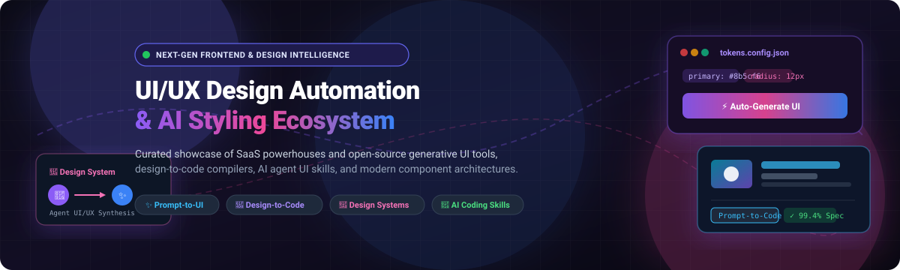

# Awesome UI/UX Design Automation & AI Styling 🎨✨

  
  
  
  
  

**A definitive, curated index of industry-leading SaaS platforms and open-source ecosystems powering AI design systems, prompt/screenshot-to-UI generation, design-to-code automation, visual DOM editors, and AI coding-agent design skills.**

*Empowering frontend engineers, UX architects, product designers, and autonomous AI developers.*

---

## 📑 Table of Contents
- [🌐 Sector Overview & Market Dynamics](#-sector-overview--market-dynamics)
- [💼 SaaS & Hosted Platforms](#-saas--hosted-platforms)
- [🔓 Open-Source GitHub Projects](#-open-source-github-projects)
- [⭐ Star History](#-star-history)
- [🤝 How to Contribute](#-how-to-contribute)
- [💖 Support & Sponsorship](#-support--sponsorship)
- [📄 Disclaimer](#-disclaimer)

---

## 🌐 Sector Overview & Market Dynamics

The global market for AI-driven design automation, generative UI, and collaborative front-end engineering software is estimated at **$5.8 billion in 2026** and projected to surpass **$18.4 billion by 2031**, compounding at an aggressive CAGR of over 26%.

Market dynamics reflect a **moderately fragmented yet top-heavy ecosystem**: foundational collaborative canvas tooling remains concentrated around market anchor Figma, while rapid disruption from multimodal LLMs (screenshot-to-code, agentic visual design skills, and full-stack generative web builders like v0, Lovable, and Bolt) has catalyzed a fragmented surge of specialized AI design-to-code, visual DOM styling, and component synthesis platforms.

---

## 💼 SaaS & Hosted Platforms

A comprehensive benchmark of premier hosted platforms and SaaS tools for UI/UX design automation, prompt-to-layout synthesis, and design-to-code pipelines—ranked by scale (valuation or annual revenue, descending).

| Platform | Category / Focus | Scale (Valuation / Revenue) | Starting Price (Paid Tier) | Free Tier / Trial Limit | Key Capabilities |
| :--- | :--- | :--- | :--- | :--- | :--- |
| **[Figma & Figma Make](https://figma.com)** 🎨 | Collaborative UI/UX & AI Canvas | **$12.5B Valuation** ($750M+ ARR) | $12/editor/month (Professional, billed annually) | Free forever plan with 3 Figma & 3 FigJam files, unlimited personal drafts, and basic collaboration | Collaborative interface design, First Draft AI layouts, native design tokens/variables, and Dev Mode code inspection |
| **[Webflow](https://webflow.com)** 🌐 | Visual CMS & Semantic Web Builder | **$4.0B Valuation** ($200M+ ARR) | $14/month (Basic plan, billed annually) | Free forever Starter plan: 2 unhosted pages, 50 CMS items, 1GB bandwidth, and webflow.io subdomain | Visual CSS Grid/Flexbox design engine, AI-assisted responsive layout and styling, and production hosting |
| **[Framer](https://framer.com)** ⚡ | Interactive Web Design & AI Publishing | **$2.0B Valuation** ($100M+ ARR) | $5/site/month (Mini plan, billed annually) | Free forever plan: unlimited personal sites, 5MB asset storage, 1,000 visitors/month, framer.app domain | AI prompt-to-site generation, interactive canvas animations, responsive breakpoint styling, and sub-second publishing |
| **[v0 by Vercel](https://v0.dev)** 🤖 | Generative UI & Next.js/Tailwind Engine | **$3.25B Parent Valuation (Vercel)** | $20/month (Premium plan) | Free forever plan: 200 free generation credits/month, community public generations | Text/image-to-UI synthesis producing clean React, Tailwind CSS, and shadcn/ui components ready to copy or deploy |
| **[Uizard](https://uizard.io)** 📱 | AI Wireframing & Prototyping (Miro) | **$1.75B Parent Valuation (Miro)** | $12/creator/month (Pro, billed annually) | Free forever plan: 2 editable projects, 10 free AI generation credits, view-only sharing | Transforms sketches, wireframes, and screenshots into multi-screen interactive mobile/web mockups |
| **[Builder.io (Visual Copilot)](https://builder.io)** 🧩 | Headless CMS & Figma-to-Code | **$250M Valuation** (Series B) | $19/user/month (Starter plan) | Free forever plan: up to 10k monthly impressions, 1 space, and community support | Bridges Figma designs directly to existing production design systems and React/Vue/Angular/Svelte codebases |
| **[Anima App](https://animaapp.com)** 🔄 | Automated Design-to-Code Pipeline | **$120M Valuation** (Series A) | $39/month (Starter plan, billed annually) | Free forever plan: 1 active project, 10 code exports/month, and unlimited public links | Converts Figma, Penpot, and Adobe XD into clean React, Tailwind CSS, Vue, and HTML frontend repositories |
| **[Relume](https://relume.io)** 📐 | AI Sitemapping & Component Systems | **$80M Valuation** (Bootstrapped/Profitable) | $32/month (Starter plan, billed annually) | Free forever plan: 1 project with up to 10 sitemap pages, 1 wireframe page, and basic component access | AI-driven prompt-to-sitemap and wireframe suite with instant 1-click export to Figma and Webflow |
| **[Locofy.ai](https://locofy.ai)** 🚀 | Large Design Models & Frontend AI | **$50M Valuation** (Seed / Pre-A) | $29/month (Individual plan) | Free forever plan: 1 project, 20 screen code exports/month, and standard code generation | AI-driven Figma/Adobe XD converter producing responsive, modular React, Next.js, Vue, and React Native code |
| **[Galileo AI](https://usegalileo.ai)** 🔮 | Text-to-UI High-Fidelity Synthesis | **$40M Valuation** (Seed) | $19/month (Standard plan) | Free forever plan: 3 free generation credits upon signup, public design exploration | Generates multi-screen editable UI designs and semantic frontend web components from natural language prompts |
| **[TeleportHQ](https://teleporthq.io)** 🛠️ | Low-Code Visual UI Builder & Exporter | **$25M Valuation** (Seed) | $15/editor/month (Professional plan) | Free forever plan: 1 project, 5MB asset storage, free hosting on teleporthq.app domain | Visual UI studio supporting real-time team collaboration, vision-to-code, and clean React/Vue/HTML export |
| **[Fronty](https://fronty.com)** 🖼️ | Screenshot & Image-to-HTML/CSS AI | **$10M Valuation** (Bootstrapped) | $4.52/month (Pro plan) | Free forever plan: 1 project, 5MB storage, Fronty-subdomain hosting with watermark | AI computer vision engine converting uploaded PNG/JPEG mockups and screenshots into responsive HTML/CSS pages |

---

## 🔓 Open-Source GitHub Projects

Curated collection of premier open-source repositories powering the modern AI UI/UX ecosystem—including AI agent design skills, visual DOM editors, design-token engines, and unstyled accessible component foundations.

> **Sorted by GitHub_Stars (descending)**

1. **[Excalidraw (`excalidraw/excalidraw`)](https://github.com/excalidraw/excalidraw)**  ✏️  
   Virtual collaborative whiteboard for sketching hand-drawn like diagrams, wireframes, and UI mockups with AI diagram generation and embeddable canvas APIs.

2. **[UI/UX Pro Max Skill (`nextlevelbuilder/ui-ux-pro-max-skill`)](https://github.com/nextlevelbuilder/ui-ux-pro-max-skill)**  🧠  
   Flagship open-source AI design intelligence skill for Claude Code, Cursor, Windsurf, Gemini CLI, and Codex providing 67+ UI styles, 96 curated color palettes, font pairings, UX guidelines, and multi-stack design system generation.

3. **[shadcn/ui (`shadcn-ui/ui`)](https://github.com/shadcn-ui/ui)**  💎  
   The de facto open-source component architecture built on Radix UI and Tailwind CSS providing copy-paste, accessible, customizable UI primitives targeted by leading AI UI generation engines.

4. **[Impeccable (`pbakaus/impeccable`)](https://github.com/pbakaus/impeccable)**  🎯  
   Open-source design vocabulary, craft standards, and automated audit layer for AI coding agents that inspects typography, color contrast, spacing, and micro-interactions while eliminating generic AI UI patterns.

5. **[Ant Design (`ant-design/ant-design`)](https://github.com/ant-design/ant-design)**  🐜  
   Enterprise-class UI design language and comprehensive React component library with powerful styling engines, token systems, and internationalization.

6. **[Tailwind CSS (`tailwindlabs/tailwindcss`)](https://github.com/tailwindlabs/tailwindcss)**  🌊  
   Utility-first open-source CSS framework powering rapid AI-assisted UI styling, custom design-token variables, and zero-runtime responsive layouts.

7. **[Storybook (`storybookjs/storybook`)](https://github.com)**  📖  
   Industry-standard frontend workshop for building, visually testing, and cataloging isolated UI components and enterprise design systems.

8. **[Screenshot-to-Code (`abi/screenshot-to-code`)](https://github.com/abi/screenshot-to-code)**  📸  
   Popular open-source tool converting UI screenshots, Figma frames, and mockups into clean HTML, Tailwind CSS, React, Vue, or Bootstrap code using multimodal vision LLMs.

9. **[Penpot (`penpot/penpot`)](https://github.com/penpot/penpot)**  🖌️  
   Leading open-source design and prototyping platform (self-hosted Figma alternative) built natively on open web standards including SVG, CSS Grid, Flexbox, and W3C Design Tokens.

10. **[tldraw (`tldraw/tldraw`)](https://github.com/tldraw/tldraw)**  📐  
    Very popular open-source collaborative canvas, infinite whiteboard SDK, and foundation for "Make Real" sketch-to-functional-UI code generators.

11. **[DaisyUI (`saadeghi/daisyui`)](https://github.com/saadeghi/daisyui)**  🌼  
    Most popular open-source semantic component class plugin for Tailwind CSS enabling instant multi-theme UI switching (`dark`, `cupcake`, `retro`, `synthwave`) with clean, concise markup.

12. **[Tabler (`tabler/tabler`)](https://github.com/tabler/tabler)**  📊  
    Open-source, highly responsive dashboard and UI kit with hundreds of pixel-perfect components, clean design tokens, and dark mode support.

13. **[Chakra UI (`chakra-ui/chakra-ui`)](https://github.com/chakra-ui/chakra-ui)**  ⚡  
    Simple, modular, and accessible component library that gives developers and AI generators the building blocks to construct modern React applications with fluid theming.

14. **[Refine (`refinedev/refine`)](https://github.com/refinedev/refine)**  🚀  
    Open-source React meta-framework for rapid development of enterprise internal tools, admin panels, and dashboards with headless UI architecture and AI generation.

15. **[Mantine (`mantinedev/mantine`)](https://github.com/mantinedev/mantine)**  🛡️  
    Comprehensive open-source React component and hook library offering 100+ customizable, accessible UI components with rich theming and CSS modules support.

16. **[HeroUI (`heroui-inc/heroui`)](https://github.com/heroui-inc/heroui)**  🦸  
    Modern open-source React UI library (formerly NextUI) built on Tailwind CSS and React Aria featuring polished default styling, smooth micro-interactions, and semantic theme tokens.

17. **[Onlook (`onlook-dev/onlook`)](https://github.com/onlook-dev/onlook)**  👁️  
    The open-source "Cursor for Designers"—a visual style editor allowing designers and engineers to visually manipulate live React and Tailwind apps directly in the browser DOM and sync clean code back to files.

18. **[GrapesJS (`GrapesJS/grapesjs`)](https://github.com/GrapesJS/grapesjs)**  🍇  
    Extensible open-source Web Builder Framework combining a visual drag-and-drop canvas, customizable style manager, responsive device switching, and clean HTML/CSS generation.

19. **[Lucide Icons (`lucide-icons/lucide`)](https://github.com/lucide-icons/lucide)**  ✨  
    Community-curated collection of 1,500+ clean, consistent vector icons natively integrated with Tailwind CSS, React, and modern generative UI tools.

20. **[Magic UI (`magicuidesign/magicui`)](https://github.com/magicuidesign/magicui)**  🪄  
    Open-source UI library of 50+ animated landing-page components, bento grids, marquees, and interactive effects built with React, TypeScript, Tailwind CSS, and Motion.

21. **[OpenUI (`wandb/openui`)](https://github.com/wandb/openui)**  💡  
    Open-source generative UI studio created by Weights & Biases that renders live interactive HTML/Tailwind/React component previews from text prompts or reference images.

22. **[Dyad (`dyad-sh/dyad`)](https://github.com/dyad-sh/dyad)**  💻  
    Free, local-first open-source AI UI and web app builder serving as a privacy-focused desktop alternative to v0, Lovable, and Bolt.

23. **[Bolt.diy (`stackblitz-labs/bolt.diy`)](https://github.com/stackblitz-labs/bolt.diy)**  ⚡  
    Official open-source community edition of Bolt.new enabling full-stack AI UI generation and live browser styling inside WebContainers using cloud or local Ollama LLMs.

24. **[Radix Primitives (`radix-ui/primitives`)](https://github.com/radix-ui/primitives)**  🧩  
    Unstyled, accessible open-source React UI primitives delivering battle-tested keyboard navigation, focus trapping, and screen-reader accessibility for design systems.

25. **[APITable (`apitable/apitable`)](https://github.com/apitable/apitable)**  📑  
    Open-source visual Airtable alternative with an extensible API-oriented interface and automated UI views for data-heavy application designs.

26. **[Base UI (`mui/base-ui`)](https://github.com/mui/base-ui)**  🧱  
    Unstyled open-source React component primitives crafted by the maintainers of Radix, Floating UI, and Material UI for fully custom-styled design systems.

27. **[Webstudio (`webstudio-is/webstudio`)](https://github.com/webstudio-is/webstudio)**  🏗️  
    Open-source visual web builder and Webflow alternative structured around modern CSS tokens, responsive visual styling, and Remix/React deployment.

28. **[Motion Primitives (`ibelick/motion-primitives`)](https://github.com/ibelick/motion-primitives)**  🎬  
    Open-source kit of composable, copy-paste animated React primitives built with Motion and Tailwind CSS for high-craft interface experiences.

29. **[Open Props (`argyleink/open-props`)](https://github.com/argyleink/open-props)**  🧪  
    Supercharged open-source CSS custom properties (`var(--size-3)`, `var(--ease-spring-2)`, perceptual color scales) enabling consistent UI styling across any framework.

30. **[Style Dictionary (`amzn/style-dictionary`)](https://github.com/amzn/style-dictionary)**  📦  
    Amazon's open-source build engine for managing W3C Design Tokens once and compiling them into CSS variables, Tailwind configs, iOS Swift, and Android XML.

31. **[Tremor (`tremorlabs/tremor`)](https://github.com/tremorlabs/tremor)**  📈  
    Modular, accessible React and Tailwind CSS component library purpose-built for rapid design and development of analytical dashboards and charts.

32. **[Tokens Studio / Cobalt UI (`drwpow/cobalt-ui`)](https://github.com/drwpow/cobalt-ui)**  ⚙️  
    Lightweight, spec-compliant W3C Design Tokens compiler transforming Figma token JSON files into synchronized CSS, Sass, TypeScript, and documentation.

---

## ⭐ Star History

---

## 🤝 How to Contribute

Contributions are warmly welcome! If you know of an outstanding SaaS tool or open-source repository driving innovation in UI/UX automation and AI styling, please propose an addition:

1. **Fork** this repository.
2. **Create a branch**: `git checkout -b feature/add-new-tool`
3. **Add the entry**: Ensure links are official, factual descriptions, and correct categories.
4. **Submit a Pull Request** with a concise description of why the tool belongs in this list.

---

## 💖 Support & Sponsorship

Thank you for exploring this curated ecosystem! If you find this resource helpful for your work, projects, or team:

- ⭐ **Star** this repository to help others discover it!
- 🍴 **Fork** and share it with your design and engineering network.
- ☕ **Support the maintainer**: Buy a coffee or become a sponsor via the [GitHub Sponsor Dashboard](https://github.com/sponsors/ishandutta2007).

Your sponsorship directly supports ongoing curation, research, and open-source tooling! 🚀

---

## 📄 Disclaimer

*All trademarks, logos, and brand names are the property of their respective owners. Mention of SaaS products or open-source software does not constitute endorsement or commercial affiliation. Descriptions and market figures reflect public industry data as of November 2026.*
